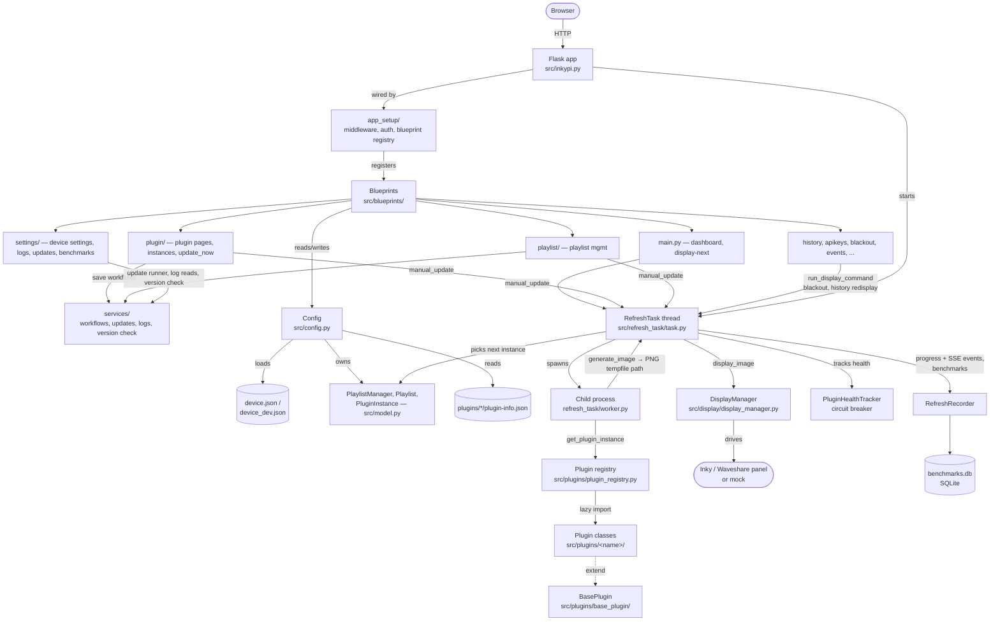

# InkyPi Architecture

A high-level map of how requests flow through the app and how the refresh loop drives the e-ink display.

## Architecture Decision Records

Non-obvious design choices are documented as Architecture Decision Records (ADRs) in [`docs/adr/`](adr/README.md). Each ADR records the context, the decision, its trade-offs, and the alternatives that were considered. File a new ADR whenever you make a choice that is hard to reverse, likely to be re-litigated, or not obvious from reading the code alone.

## Overview

InkyPi is a Flask web app (served by waitress) plus a background refresh thread, both in one process. The web UI lets the user configure plugins and assemble them into playlists; the refresh thread picks the next plugin from the active playlist on a schedule, renders it in a child process, and pushes the resulting image to the display.

The refresh thread is the single owner of the panel. Web routes that change what is on screen hand their work to it rather than writing to the panel themselves, except in web-only mode (`--web-only`), where no refresh thread runs.

## Component diagram

## Request flow (web UI)

1. Browser sends an HTTP request. Before-request hooks from `src/app_setup/` run first (Host allow-list, optional PIN auth, CSRF check, rate limiting, CSP nonce); an after-request hook adds the security headers.
2. A route in one of the blueprints handles it. Most routes read or write `Config` and `PlaylistManager`, which are persisted to `device.json`. Saving plugin settings and adding a plugin instance to a playlist go through the workflows in `src/services/`.
3. To render a plugin's settings page, the blueprint calls the plugin's `generate_settings_template()`.
4. Routes that put something on the panel do not write to it directly while the refresh thread is running:
   - `/update_now`, `/display-next`, `/display_next_in_playlist` and `/display_plugin_instance` call `RefreshTask.manual_update()`. It queues a request for the refresh thread and blocks until the rendered image is saved to disk (not until the slower panel write finishes). It waits twice, each time for the plugin's whole render budget (every attempt the retry policy allows, plus 30 s): once for the loop to take the request, then for the image. A request the loop never took is withdrawn and reported as busy (503 `refresh_loop_busy`). Giving up on a render that is still running reports a timeout (504) but records no plugin failure, because the render records its own outcome when it ends.
   - Blackout and history redisplay call `RefreshTask.run_display_command()`, which runs a callable against `DisplayManager` on the refresh thread.
   - `/update_now` with `X-Async: true` (or `?async=1`) enqueues the same work on a small thread pool (`refresh_task/job_queue.py`) and returns 202 with a job id to poll at `/api/job/<job_id>`, and `wait_s`, the longest that job can take, so the page waits that long before it reports a timeout.
5. When the refresh thread is not running (web-only mode), `/update_now` and `/display-next` call `generate_image()` in the request thread and push the result to `DisplayManager` themselves (`services/direct_render.py` holds the outcome handling for `/update_now`).
6. HTML responses are rendered with Jinja2 from `src/templates/` (and plugin templates under `src/plugins/`). JSON responses use the envelope helpers in `utils/api_responses.py`.

## Refresh flow (background)

1. `RefreshTask.start()` launches the `RefreshTask` thread (`_run`), plus a systemd watchdog heartbeat thread when `cysystemd` is available. In normal operation `inkypi.py`'s `__main__` block starts it; web-only mode skips it.
2. The loop waits on a condition variable (`RefreshScheduler.wait_for_trigger`) until the active playlist's next refresh is due, a playlist window opens or closes, or a web thread queues a manual request or signals a config change.
3. A queued display command runs as is, and a queued manual refresh brings its own action. Otherwise, unless blackout is active, the loop picks the next plugin instance (`_determine_next_plugin`) when the wake-up found a scheduled refresh due (`Trigger.due`): the active playlist's next eligible instance, skipping instances paused by the circuit breaker unless a probe is due.
4. `RefreshExecutor.execute_with_policy` runs the plugin in a **child process** (`forkserver` where available) with a timeout and retries. The child (`_execute_refresh_attempt_worker`) rebuilds `Config` from a picklable `RefreshContext` (which carries the hash of the `device.json` content the parent already validated, so the child skips validating identical bytes and never imports jsonschema), re-registers plugins, runs the refresh action (which calls the plugin's `generate_image()` and saves the plugin's cache PNG), and sends back that file's path (or a tempfile's, when there is no cache file) plus any plugin-state changes over a `multiprocessing` queue. Setting `INKYPI_PLUGIN_ISOLATION=none` runs plugins in a thread in the main process instead.
5. Back on the refresh thread (`_perform_refresh`), the image is fitted to the panel size and hashed. The panel write is skipped only when the panel already shows this image with the current display settings (`DisplayManager.panel_shows`); an error card, a history redisplay or a settings change since the last refresh means it is written again. A plugin failure pushes a fallback error card (`utils/fallback_image.py`), except on the automatic retry of a paused plugin, which keeps the current frame.
6. `DisplayManager.display_image()` saves the raw preview (a byte copy of the plugin's cache PNG when the frame was not refitted, so the same pixels are not encoded twice), applies orientation, resizing, enhancement and crisp colour snapping, saves the processed image and a history entry, signals any waiting manual request, then writes to the panel driver.
7. The loop updates plugin health (success/failure counts, circuit-breaker state, failure webhooks), publishes progress and SSE events, records benchmarks, and persists `refresh_info` to `device.json`.

## Config and storage

- `device.json` (or `device_dev.json` in dev mode) holds device settings, playlists, saved plugin instances (including their circuit-breaker state) and the last `refresh_info`. `Config._determine_config_path` picks the file.
- `Config` reads it at startup and keeps it in memory. Writes go through `write_config()` / `update_atomic()`, which hold a reentrant lock, write atomically, and roll the in-memory state back if the write fails. See [ADR-0004](adr/0004-json-config-store.md).
- `PlaylistManager`, `Playlist`, `PluginInstance` and `RefreshInfo` (`src/model.py`) are the in-memory models that `Config` serialises back into `device.json`.
- Plugin metadata is not in `device.json`: `Config.read_plugins_list()` reads each `src/plugins/<id>/plugin-info.json`.
- API keys live in the project's `.env` file (`Config.load_env_key` / `set_env_key`), not in `device.json`.
- Images are plain files: the current and processed previews, per-plugin images, and history PNGs with JSON sidecars (paths in `utils/paths.py`; history stats in `utils/refresh_stats.py`).
- Plugin-instance settings history is a JSONL file per instance (`utils/plugin_history.py`).
- Refresh and per-stage benchmark timings go to a SQLite database (`runtime/benchmarks.db` by default) written by `src/benchmarks/benchmark_storage.py` and read by the benchmark routes in `blueprints/settings/_benchmarks.py`. It is the only database; everything else is JSON or files.

## Plugin lifecycle

- At startup, `plugin_registry.load_plugins()` checks each plugin listed by `Config.get_plugins()` (directory and module exist, id is a safe module name, not disabled), reads its version metadata, and registers its config. It does **not** import the plugin.
- `get_plugin_instance()` imports `plugins.<id>.<id>` and instantiates the class on first use, then caches the instance. In dev mode it re-instantiates on every call and reloads the module (unless `INKYPI_NO_HOT_RELOAD` is set), so code edits show up without a restart.
- The refresh child process starts with an empty registry, so the worker calls `load_plugins()` again before looking the plugin up.
- Each `PluginInstance` is a saved configuration of a plugin (e.g., "Weather — Home" and "Weather — Work" are two instances of the weather plugin). The refresh loop runs one `PluginInstance` per cycle.
- `BasePlugin` (`src/plugins/base_plugin/base_plugin.py`) gives plugins `generate_settings_template()`, `validate_settings()`, an optional `skip_display_condition()`, and `render_image()`, which renders an HTML template and screenshots it with headless Chromium (`utils/image_utils.py`). `utils/chromium_limiter.py` holds a cross-process lock so only one Chromium runs at a time.

## Module map

### `src/inkypi.py`

The entry point. `main()` parses CLI flags (`--dev`, `--web-only`, `--fast-dev`, `--run-once`, `--config`, `--port`). `create_app()` builds the Flask app and calls `_init_core_services()`, which creates `Config`, `DisplayManager` and `RefreshTask`, registers plugins, and stores them on `app.config` as `DEVICE_CONFIG`, `DISPLAY_MANAGER` and `REFRESH_TASK`. The `__main__` block starts the refresh thread and the boot display tasks (self-test, startup image), notifies systemd, and serves the app with waitress. `run_once()` renders one playlist plugin through the refresh loop and exits, for cron or timer setups.

### `src/app_setup/`

App wiring split out of `inkypi.py`: `blueprints_registry.register_blueprints`, `security_middleware` (secret key, HTTPS redirect, Host allow-list, CSP nonce, CSRF, rate limiting, security headers; uses `scheme_proxy` for proxy scheme trust), `auth` (optional PIN login and read-only bearer token), `error_handlers`, `health` (`/healthz`, `/readyz`), `http_metrics` (Prometheus request timing), `logging_setup`, `signals`, `asset_helpers` (bundled asset names), `schema_validator` (dev-only JSON response checks against `src/schemas/`), and `smoke` (an opt-in render endpoint for the install memory test).

### `src/blueprints/`

The Flask routes. The larger areas are packages whose `__init__` documents which module holds which routes:

- `plugin/` — plugin settings pages and settings save, instance update/delete/display/force-retry, `/update_now` (`_update_now.py`), and plugin images.
- `playlist/` — playlist pages, CRUD, `/display_next_in_playlist`, and the rotation ETA maths in `_schedule.py`.
- `settings/` — device settings, import/export, API keys, logs, health, updates and rollback, and the benchmark API (which reads the SQLite benchmarks database).

Single modules cover the rest: `main` (dashboard, previews, `/display-next`, `/refresh-info`, `/next-up`), `history`, `apikeys`, `auth`, `blackout`, `events` (SSE stream of refresh events), `diagnostics`, `stats`, `metrics`, `version_info`, `plugin_history_bp`, `plugin_io` (instance export/import), `api_docs`, and the browser-report endpoints `client_error`, `client_log`, `csp_report` and `errors`.

### `src/services/`

Logic the blueprints call directly, kept out of the route modules:

- Flask-free workflows: `plugin_workflows` (saving plugin settings and the saved-settings instance), `playlist_workflows` (adding an instance to a playlist and validating its settings), and `direct_render` (the outcome policy for a `/update_now` render that runs outside the refresh loop).
- Behind the settings routes: `updates` (finding and validating the update and rollback scripts, launching them with `systemd-run` or a simulated thread off-device, and the in-memory update state and lock), `logs` (journal reads, and the in-memory buffer that stands in for the journal in dev mode; it reads the device timezone from the Flask app context) and `version_check` (the cached GitHub latest-release check behind `/api/version`). Tests patch names on these modules, for example `services.updates._systemd_available`.

### `src/refresh_task/`

The background refresh loop. `RefreshTask` (`task.py`) owns the thread, the loop in `_run`, and the plugin execution wrappers; the rest of its behaviour is split into mixins and helpers:

- `loop_scheduling.py` (`SchedulingMixin`) — trigger waits, next-plugin selection, the watchdog stall gate, history and upload cleanup, and system stats.
- `command_queue.py` (`CommandQueueMixin`) — `manual_update()`, `run_display_command()`, and per-plugin timeouts.
- `refresh_cycle.py` (`RefreshCycleMixin`) — one refresh, `_perform_refresh`, from generate through display and record.
- `health_hooks.py` (`PluginHealthMixin`) and `health.py` (`PluginHealthTracker`) — success/failure counts, the circuit breaker, probe retries and crash quarantine.
- `executor.py` (`RefreshExecutor`) — retry, timeout and isolation policy (an attempt stopped at its time limit is not retried: a second try doubles the wait, and for an AI image the bill); `worker.py` — the child-process entry point and `_get_mp_context`; `context.py` — the picklable `RefreshContext` the child rebuilds `Config` from.
- `actions.py` — `RefreshAction` and its subclasses (`PlaylistRefresh`, `ManualRefresh`, `DisplayCommand`) and the `ManualUpdateRequest` queue entry.
- `scheduler.py` (`RefreshScheduler`) — the condition wait and watchdog cadence; `schedule.py` — pure next-due maths used by the scheduler and next-plugin selection.
- `display_pipeline.py` (`DisplayPipeline`) — the display push, cache skip and image-saved signal; `housekeeping.py` (`RefreshHousekeeper`) — history cleanup, deleting unused uploads (`utils/upload_cleanup.py`), history metadata and the fallback image push; `recorder.py` (`RefreshRecorder`) — progress events, SSE events and benchmark writes.
- `plugin_lookup.py` — the single place the loop resolves `get_plugin_instance`; `job_queue.py` — the thread pool behind async `/update_now`.

### `src/plugins/`

One directory per plugin (`<id>/<id>.py`, `plugin-info.json`, templates and assets), the shared `base_plugin/` (`BasePlugin`, HTML render template, frames, settings schema helpers), and `plugin_registry.py` (lazy loading, described above).

### `src/display/`

`DisplayManager` picks a driver from `display_type` in `device.json` (`mock`, `inky`, or a Waveshare `epd*in*` model), runs the image pipeline described in the refresh flow, and keeps the preview and history files. Drivers implement `AbstractDisplay`: `inky_display.py`, `waveshare_display.py` (with the vendored `waveshare_epd/`), and `mock_display.py`. `crisp.py` is the undithered colour conversion for rendered UI on colour panels; `rendering_settings.py` holds its setting names.

### `src/config.py`, `src/model.py`, `src/config/`

`Config` and the playlist models (see "Config and storage"). `src/config/` holds the JSON Schemas for `device.json` (enforced on load by `utils/config_schema.py`) and `plugin-info.json`, `logging.conf`, and `device_dev.json`.

### `src/benchmarks/`

`benchmark_storage.py` writes refresh and stage timings to the SQLite benchmarks database. Writing is best-effort and controlled by `enable_benchmarks` and `benchmark_sample_rate`. The schema is checked once per database per process, and `prune_benchmarks` (run by the refresh loop's housekeeping) deletes rows older than 30 days.

### `src/schemas/`

`TypedDict` shapes for the main JSON responses, used by contract tests, mypy, and the dev-only response validator.

### `src/utils/`

Shared helpers, grouped roughly as:

- **Outbound HTTP.** Import each helper from the module that defines it: `http_transport.py` (`http_get` and its per-thread pooled session), `safe_fetch.py` (SSRF-guarded fetches with per-hop validation and size caps), `dns_pinning.py` (`pinned_dns`), and `api_responses.py` (the JSON envelope: `json_success`, `json_error`). `http_client.py` provides `get_http_session()`, the shared session for plugins. See [http_performance.md](http_performance.md).
- **Security and input.** `security_utils.py` (URL and path validation), `remote_rendering.py` (the proxy that keeps remote-page Chromium renders on public addresses), `rate_limit.py`, `form_utils.py`, `request_models.py`.
- **Images and rendering.** `image_utils.py`, `image_loader.py`, `image_serving.py`, `output_validator.py`, `fallback_image.py`, `chromium_limiter.py`, `icon_utils.py`.
- **Errors.** `plugin_errors.py` (permanent vs transient plugin failures), `domain_errors.py` (HTTP-free failures the core raises, such as a stopped refresh loop or blackout), and `backend_errors.py` (typed route errors, plus `route_error_for`, the one mapping from a known failure to a status and code).
- **Events and observability.** `event_bus.py` and `progress_events.py` (feeds for the SSE routes), `sse.py` (stream limits), `progress.py`, `metrics.py` (Prometheus), `logging_utils.py`, `webhooks.py`.
- **Device state and boot.** `blackout.py`, `boot_self_test.py`, `crash_breadcrumb.py`, `asset_check.py`, `history_cleanup.py`, `refresh_stats.py`, `plugin_history.py`.
- **General.** `paths.py`, `time_utils.py`, `env_flags.py`, `app_utils.py`, `app_version.py`, `config_schema.py`, `display_names.py`, `i18n.py`, `sri.py`, `messages.py`, `client_endpoint.py`, `google_ai.py`.

### `src/templates/`, `src/static/`

Jinja2 page templates and the front-end assets (JS, CSS, images). `scripts/build_assets.py` writes the minified bundles to `static/dist/`, which `app_setup/asset_helpers.py` resolves.

## Where to look next

- New to the codebase? Start with `create_app()` and `_init_core_services()` in `src/inkypi.py` to see the wiring, then `src/app_setup/`.
- Building a plugin? See [building_plugins.md](building_plugins.md) — there's a hello-world walkthrough at the bottom.
- Understanding the refresh loop? Start at `RefreshTask._run` in `src/refresh_task/task.py`; next-plugin selection (`_determine_next_plugin`) is in `loop_scheduling.py`, one refresh (`_perform_refresh`) in `refresh_cycle.py`, manual updates in `command_queue.py` and `_update_plugin_health` in `health_hooks.py`.
- Display drivers? `src/display/` — `DisplayManager` selects the driver based on `device.json`.
